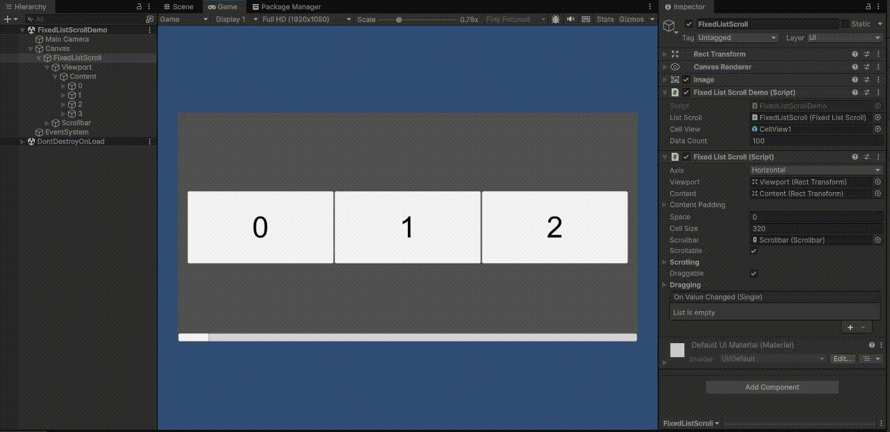
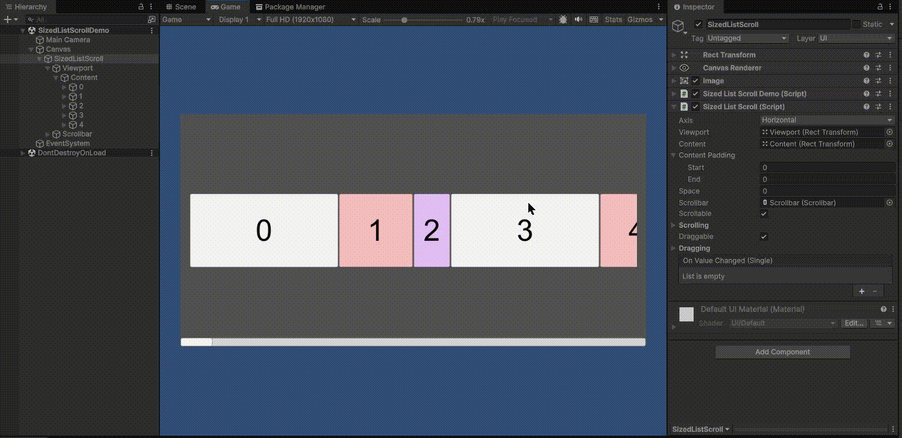
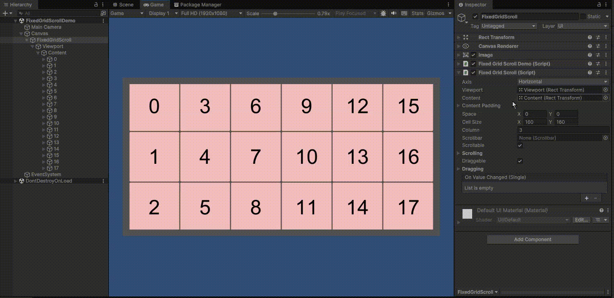
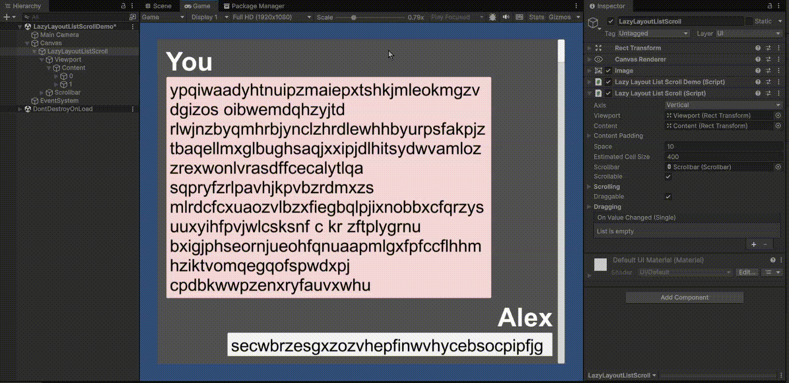
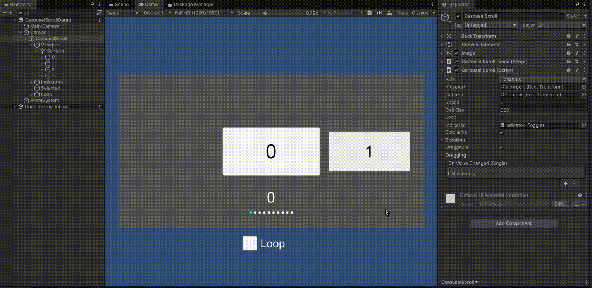
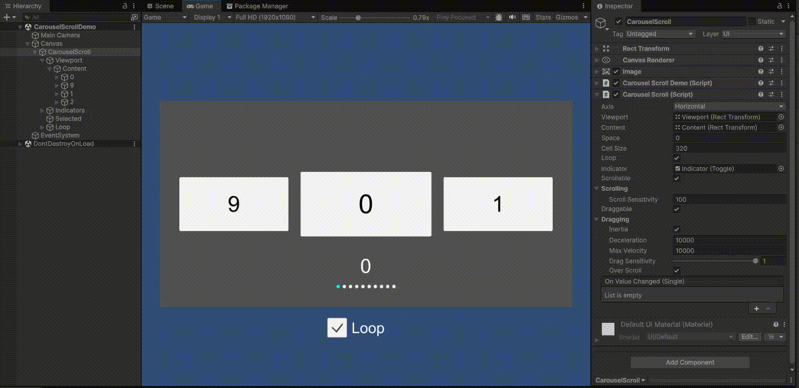

**Unity uGUI向けの、セルを再利用するリスト・グリッド・カルーセル。**

レイアウトに合うコンポーネントを選び、データを渡すだけ。スクロールに合わせたセルの生成と再利用は、SimpleScrollが担当します。

[English](README.md) · [インストール](#インストール) · [使い始める](#使い始める) · [デモ](#デモ)

## 特徴

- **用途に合わせて選べる。** 固定サイズ、可変サイズ、自動計測、グリッド、カルーセルを用意しています。
- **仮想化とセルの再利用。** 表示領域に必要なセルを生成し、画面外に出たセルを再利用します。
- **データとPrefabは自由に。** 小さなデータソースインターフェースで連携でき、複数のセル種類にも対応します。
- **縦・横の両方向に対応。** スクロール軸、ドラッグ、慣性、マウスホイール操作をInspectorで設定できます。

## どれを使う？

| コンポーネント | セルサイズ | 向いている用途 |
| --- | --- | --- |
| `FixedListScroll` | スクロール軸方向のサイズが共通 | メニュー、ランキング、均一な行のリスト |
| `SizedListScroll` | データ側で各セルのサイズを指定 | サイズが分かっているフィードや可変長リスト |
| `LazyLayoutListScroll` | 各セルのRectTransformから計測 | チャット、内容に応じてサイズが変わるUI |
| `FixedGridScroll` | 幅・高さが共通 | インベントリ、ショップ、ギャラリー |
| `CarouselScroll` | スクロール軸方向のサイズが共通 | 中央にスナップするカード、ループするスライダー |

全行が同じサイズなら`FixedListScroll`、サイズをデータから求められるなら`SizedListScroll`、UIをレイアウトして初めてサイズが決まるなら`LazyLayoutListScroll`を選びます。

## インストール

パッケージでは最低対応バージョンとして**Unity 2022.1**を指定しています。**uGUI**を使用するため、プロジェクトにUnity UIを導入してください。

UnityのPackage Managerで**Add package from git URL**を選び、次のURLを入力します。

```text
https://github.com/kurobon-jp/SimpleScroll.git?path=Assets/
```

## 使い始める

### 1. ビューを用意する

まずは`FixedListScroll`のサンプルをベースにすると簡単です。自分で作る場合は、次のように設定します。

1. Canvasの下に、Viewportと、その子になるContentのRectTransformを用意します。
2. スクロールビューのGameObjectに`FixedListScroll`を追加し、**Viewport**と**Content**を割り当てます。
3. スクロール軸とセルサイズを設定します。Prefabのスクロール軸方向のサイズを、設定値に合わせてください。
4. Viewportに`RectMask2D`または`Mask`を追加して表示領域を切り抜きます。入力を受け取るため、ビューにレイキャスト対象のUI Graphic、シーンにEventSystemを用意します。

セルの配置はSimpleScrollが管理します。ContentにLayout Groupを追加したり、同じContentをScrollRectで動かしたりせず、配置をSimpleScrollに任せてください。`LazyLayoutListScroll`では、セル内部のLayoutコンポーネントを使えます。

### 2. データを渡す

次のコードを`SimpleListExample.cs`として保存し、GameObjectに追加します。スクロールコンポーネントとセルPrefabを割り当ててください。PrefabにはRectTransformと、子のuGUI `Text`が必要です。

```csharp
using SimpleScroll;
using UnityEngine;
using UnityEngine.UI;

public class SimpleListExample : MonoBehaviour, IDataSource
{
    [SerializeField] private FixedListScroll _scroll;
    [SerializeField] private GameObject _cellPrefab;
    [SerializeField] private int _count = 100;

    private void Start()
    {
        _scroll.SetDataSource(this);
        _scroll.Refresh();
    }

    public int GetDataCount() => _count;
    public GameObject GetCellView(int index) => _cellPrefab;
    public int GetCellViewType(int index) => 0;

    public void SetData(int index, GameObject cell)
    {
        cell.GetComponentInChildren<Text>().text = $"Item {index}";
    }
}
```

この例は単体で理解できるように`Text`を検索しています。実際のプロジェクトでは、専用のセルコンポーネントを通して表示を更新すると扱いやすくなります。

### 3. データ更新と移動

データを変更したら`Refresh()`を呼びます。表示中のセルへの再バインドと、レイアウトの再計算が行われます。セルの配置はスクロールコンポーネントの`LateUpdate`で反映されます。

```csharp
_scroll.Refresh();
_scroll.SetPositionIndex(20, anchor: 0.5f, smooth: true);
```

リストの`anchor`はViewport内の配置位置です。`0`は先頭、`0.5`は中央、`1`は末尾に合わせます。実際の移動先はスクロール可能な範囲に制限されます。

正規化位置を指定して更新する場合は、先頭なら`Refresh(0f)`、末尾なら`Refresh(1f)`を使います。データ変更後にインデックスへ移動するときは、先に`Refresh()`でサイズとオフセットを更新してください。

#### Refreshの引数

```csharp
void Refresh(float normalizedPosition, bool isRefreshVisibleCells = true)
```

レイアウトを再計算し、指定した正規化位置へ移動します。

| 引数 | 説明 |
| --- | --- |
| `normalizedPosition` | スクロール可能な範囲内の位置（`0`〜`1`）。`0`が先頭、`1`が末尾です。 |
| `isRefreshVisibleCells` | `true`（既定値）で表示中のセルにもデータを再バインドします。`false`では表示中のセルを維持し、レイアウトを再計算します。表示内容も変更した場合は`true`を使ってください。 |

`Refresh(bool isRefreshVisibleCells = true)`では、正規化位置を指定せずに更新できます。

`LazyLayoutListScroll`では、未計測セルの推定サイズを使って全体の長さを計算するため、`normalizedPosition`が`0`・`1`以外の場合、すべてのセルを計測した場合の位置との間に誤差が出ることがあります。特定の項目へ移動したい場合は`SetPositionIndex`を使ってください。

## データソースとセルの再利用

| メソッド | 役割 |
| --- | --- |
| `GetDataCount()` | データの件数を返します。 |
| `GetCellView(index)` | 対象データに使うPrefabを返します。 |
| `GetCellViewType(index)` | セル種類ごとのプールキーを返します。既定値は`0`です。 |
| `SetData(index, cell)` | 生成・再利用されたセルにデータを反映します。 |

複数のPrefabを使う場合は、セルの種類ごとに異なるタイプIDを返し、`GetCellView`で対応するPrefabを選んでください。同じタイプIDのセルはプールを共有します。

再利用されたセルには、以前のデータの状態が残っていることがあります。`SetData`ではテキスト、画像、選択状態、コールバックなど、データに依存する状態をすべて更新してください。クリックイベントも、バインドのたびに追加せず、以前のコールバックを置き換えます。

`SizedListScroll`には`ISizedDataSource`を使います。追加の`GetCellViewSize(index)`で、スクロール軸方向のセルサイズを返します。セル間の余白は含めません。

`LazyLayoutListScroll`には`ILazyLayoutDataSource`を使います。`LazyLayoutDataSource<T>`を継承すると、データコレクションとサイズ・オフセットの管理を利用できます。`SetData`、`GetCellView`、`GetCellViewType`を実装してください。[LazyLayoutListScrollDemo.cs](Assets/Samples~/Scripts/LazyLayoutListScrollDemo.cs)が参考になります。

## レイアウトごとの使い方

### グリッド

`FixedGridScroll.Column`は、スクロール軸と直交する方向に並べるセル数です。縦スクロールでは列数、横スクロールでは行数になります。

### カルーセル

`CarouselScroll`はセルを中央にスナップさせ、ループにも対応します。`Next()`、`Prev()`、`SetPositionIndex(index, smooth)`で移動できます。

ループ時の位置インデックスは、負数やデータ件数以上になることがあります。インデックスを受け取る**すべてのデータソースメソッド**で、`IDataSource.GetDataIndex(positionIndex)`を使って有効なデータインデックスに変換してください。`OnSelected`が返す値も位置インデックスです。

`OnReposition`では、セル、位置インデックス、Viewport中央からの符号付き距離（Viewportサイズの半分で正規化）を受け取れます。拡大縮小などの演出に使えます。[CarouselScrollDemo.cs](Assets/Samples~/Scripts/CarouselScrollDemo.cs)を参照してください。

### 自動計測するリスト

`LazyLayoutListScroll`は、最初は推定サイズで計算し、表示したセルを計測します。実際のサイズが分かるにつれて、コンテンツ全体の長さやスクロールバーが変化することがあります。計測にはレイアウトの再構築とオフセットの再計算が必要なので、サイズが分かっている場合は`SizedListScroll`を選んでください。

## コンポーネントのパラメータ

Inspectorに表示される項目の説明です。サイズと余白はRectTransformのローカル座標単位で指定します。

### 共通設定

| パラメータ | 説明 |
| --- | --- |
| **Axis** | `Horizontal`（横）または`Vertical`（縦）を選びます。 |
| **Viewport** | 表示領域のRectTransform。未指定の場合は、このコンポーネント自身のRectTransformを使います。 |
| **Content** | セルを配置する親RectTransform。Viewportの子を割り当てます。 |
| **Scrollable** | マウスホイールなどのスクロール入力を受け付けます。 |
| **Scrolling / Scroll Sensitivity** | スクロール入力の移動量。大きいほど移動量が増えます。カルーセルでは項目の切り替え量に影響します。 |
| **Draggable** | ポインターによるドラッグ操作を受け付けます。 |
| **Dragging / Inertia** | ドラッグを離した後の慣性移動を有効にします。 |
| **Dragging / Deceleration** | 慣性の減速量（px/sec²）。大きいほど短い距離で止まります。既定値は`10000`です。 |
| **Dragging / Max Velocity** | 慣性移動の最大速度（px/sec）。既定値は`10000`です。 |
| **Dragging / Drag Sensitivity** | ドラッグ移動量の倍率（`0.1`〜`1`）。`1`でポインターと同じ移動量になります。 |
| **Dragging / Over Scroll** | スクロール範囲の端を越える移動を許可します。|
| **On Value Changed** | スクロール位置の変化を通知するイベント。値は正規化位置ではなく、符号付きのスクロール座標です（横は先頭から負方向、縦は正方向）。 |

### リスト・グリッド共通

| パラメータ | 説明 |
| --- | --- |
| **Content Padding / Start・End** | スクロール軸方向の先頭・末尾の余白。縦では上・下、横では左・右です。 |
| **Space** | セル間の余白。リストはスクロール軸方向の値、グリッドは`X`（横）・`Y`（縦）の値です。 |
| **Scrollbar** | 任意のuGUI Scrollbar。位置とハンドルサイズを同期し、スクロール不要時はGameObjectを非表示にします。方向はスクロール軸に合わせ、値`0`が先頭になるよう設定してください。 |

### FixedListScroll

| パラメータ | 説明 |
| --- | --- |
| **Cell Size** | 全セル共通のスクロール軸方向のサイズ。セル間の余白は含めません。Prefabのサイズもこの値に合わせます。 |

### LazyLayoutListScroll

| パラメータ | 説明 |
| --- | --- |
| **Estimated Cell Size** | 未計測セルのスクロール軸方向の推定サイズ。既定値は`100`です。実際のセルに近い値にすると、計測後のコンテンツ長やスクロールバーの変化を抑えられます。セル間の余白は含めません。 |

### FixedGridScroll

| パラメータ | 説明 |
| --- | --- |
| **Cell Size / X・Y** | 全セル共通の幅・高さ。セル間の余白は含めません。Prefabのサイズもこの値に合わせます。 |
| **Column** | スクロール軸と直交する方向に並べるセル数。縦スクロールでは列数、横スクロールでは行数です。`1`以上を指定します。 |

### CarouselScroll

| パラメータ | 説明 |
| --- | --- |
| **Cell Size** | 全セル共通のスクロール軸方向のサイズ。Prefabのサイズもこの値に合わせます。 |
| **Space** | スクロール軸方向のセル間の余白。中心間の距離は`Cell Size + Space`です。 |
| **Loop** | 末尾から先頭、先頭から末尾へ続くループを有効にします。無効時は最初・最後のセルで止まります。 |
| **Indicator** | 任意のuGUI Toggleテンプレート。データ件数分を同じ親の下に複製し、選択中の項目を`isOn`で表示します。元のテンプレートは非表示になります。 |

カルーセルは中央へのスナップで配置するため、Content Paddingは使用しません。セルサイズは正の値にし、`Cell Size + Space`も正になるよう設定してください。

## コンパイルチェック CI

GitHub Actions で Unity 2022.1.25f1 のパッケージとサンプルスクリプトのコンパイルを確認します。実行には Unity ライセンス用の Repository Secrets が必要です。[設定方法と検証範囲](.github/unity/README.md)を参照してください。

## デモ

### FixedListScroll



### SizedListScroll



### FixedGridScroll



### LazyLayoutListScroll



### CarouselScroll



### CarouselScroll loop



## ライセンス

[MIT](LICENSE)
