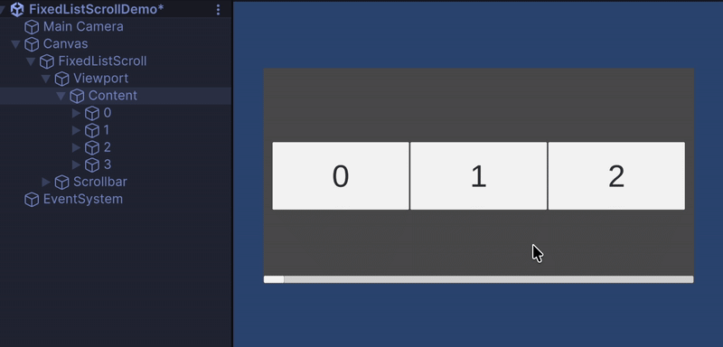
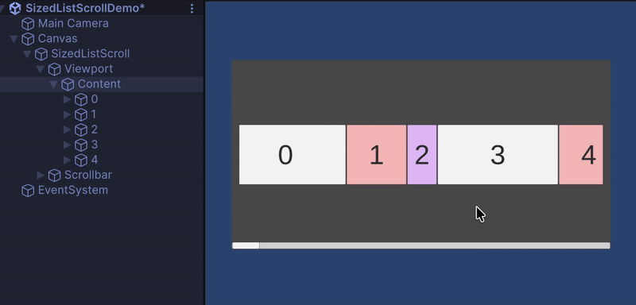
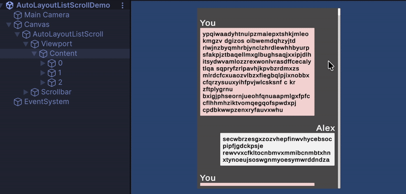
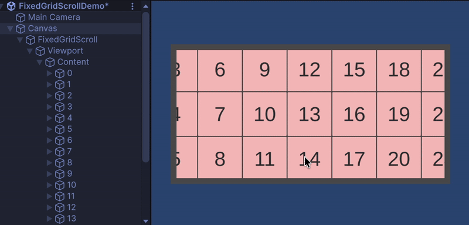
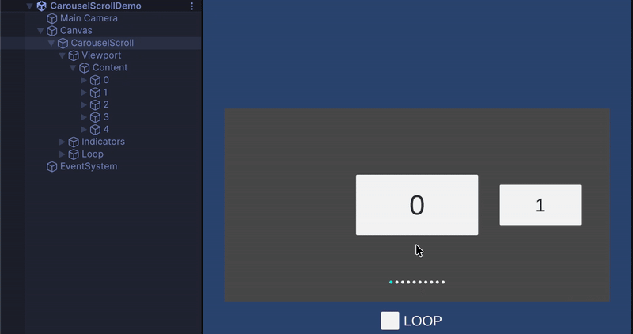
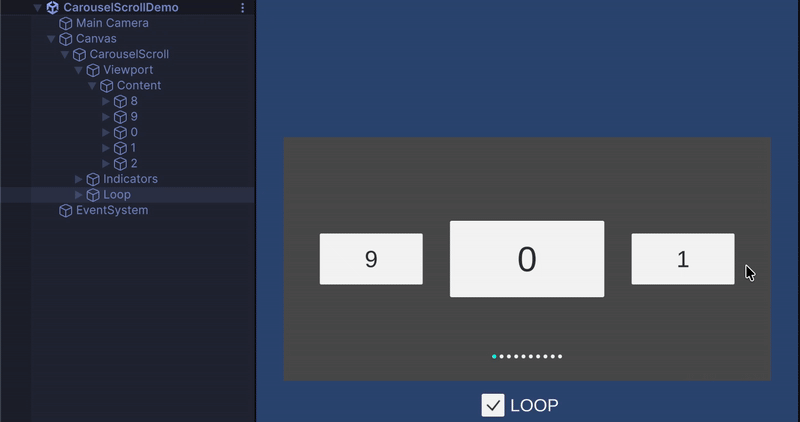

**Unity uGUI向けの、セルを再利用するリスト・グリッド・カルーセル。**

レイアウトに合うコンポーネントを選び、データを渡すだけ。スクロールに合わせたセルの生成と再利用は、SimpleScrollが担当します。

[English](README.md) · [インストール](#インストール) · [使い始める](#使い始める) · [サンプル](#サンプル)

## 特徴

- **用途に合わせて選べる。** 固定サイズ、可変サイズ、自動計測、グリッド、カルーセルを用意しています。
- **仮想化とセルの再利用。** 表示領域に必要なセルを生成し、画面外に出たセルを再利用します。
- **データとPrefabは自由に。** 小さなデータソースインターフェースで連携でき、複数のセル種類にも対応します。
- **縦・横の両方向に対応。** スクロール軸、ドラッグ、慣性、マウスホイール操作をInspectorで設定できます。

## どれを使う？

| コンポーネント | セルサイズ | 向いている用途 |
| --- | --- | --- |
| `FixedListScroll` | スクロール軸方向のサイズが共通 | メニュー、ランキング、均一な行のリスト |
| `SizedListScroll` | データ側で各セルのサイズを指定 | サイズが分かっているフィードや可変長リスト |
| `LazyLayoutListScroll` | 各セルのRectTransformから計測 | チャット、内容に応じてサイズが変わるUI |
| `FixedGridScroll` | 幅・高さが共通 | インベントリ、ショップ、ギャラリー |
| `CarouselScroll` | スクロール軸方向のサイズが共通 | 中央にスナップするカード、ループするスライダー |

全行が同じサイズなら`FixedListScroll`、サイズをデータから求められるなら`SizedListScroll`、UIをレイアウトして初めてサイズが決まるなら`LazyLayoutListScroll`を選びます。

## インストール

パッケージでは最低対応バージョンとして**Unity 2022.1**を指定しています。**uGUI**を使用するため、プロジェクトにUnity UIを導入してください。

UnityのPackage Managerで**Add package from git URL**を選び、次のURLを入力します。

```text
https://github.com/kurobon-jp/SimpleScroll.git?path=Assets/
```

### サンプル

Package ManagerでSimpleScrollを選び、Samples欄の**SimpleScroll Sample**をインポートしてください。デモシーンを開くと、ヒエラルキー、Inspector設定、データの渡し方を確認できます。

主なサンプルは[Samples~/Scripts](Assets/Samples~/Scripts)と[Samples~/Scenes](Assets/Samples~/Scenes)にあります。

## 使い始める

### 1. ビューを用意する

まずは`FixedListScroll`のサンプルをベースにすると簡単です。自分で作る場合は、次のように設定します。

1. Canvasの下に、Viewportと、その子になるContentのRectTransformを用意します。
2. スクロールビューのGameObjectに`FixedListScroll`を追加し、**Viewport**と**Content**を割り当てます。
3. スクロール軸とセルサイズを設定します。Prefabのスクロール軸方向のサイズを、設定値に合わせてください。
4. Viewportに`RectMask2D`または`Mask`を追加して表示領域を切り抜きます。入力を受け取るため、ビューにレイキャスト対象のUI Graphic、シーンにEventSystemを用意します。

セルの配置はSimpleScrollが管理します。ContentにLayout Groupを追加したり、同じContentをScrollRectで動かしたりせず、配置をSimpleScrollに任せてください。`LazyLayoutListScroll`では、セル内部のLayoutコンポーネントを使えます。

### 2. データを渡す

次のコードを`SimpleListExample.cs`として保存し、GameObjectに追加します。スクロールコンポーネントとセルPrefabを割り当ててください。PrefabにはRectTransformと、子のuGUI `Text`が必要です。

```csharp
using SimpleScroll;
using UnityEngine;
using UnityEngine.UI;

public class SimpleListExample : MonoBehaviour, IDataSource
{
    [SerializeField] private FixedListScroll _scroll;
    [SerializeField] private GameObject _cellPrefab;
    [SerializeField] private int _count = 100;

    private void Start()
    {
        _scroll.SetDataSource(this);
        _scroll.Refresh();
    }

    public int GetDataCount() => _count;
    public GameObject GetCellView(int index) => _cellPrefab;
    public int GetCellViewType(int index) => 0;

    public void SetData(int index, GameObject cell)
    {
        cell.GetComponentInChildren<Text>().text = $"Item {index}";
    }
}
```

この例は単体で理解できるように`Text`を検索しています。実際のプロジェクトでは、専用のセルコンポーネントを通して表示を更新すると扱いやすくなります。

### 3. データ更新と移動

データを変更したら`Refresh()`を呼びます。表示中のセルへの再バインドと、レイアウトの再計算が行われます。セルの配置はスクロールコンポーネントの`LateUpdate`で反映されます。

```csharp
_scroll.Refresh();
_scroll.SetPositionIndex(20, anchor: 0.5f, smooth: true);
```

リストの`anchor`はViewport内の配置位置です。`0`は先頭、`0.5`は中央、`1`は末尾に合わせます。実際の移動先はスクロール可能な範囲に制限されます。`FixedGridScroll`では、この引数名は`pivot`です。

正規化位置を指定して更新する場合は、先頭なら`Refresh(0f)`、末尾なら`Refresh(1f)`を使います。データ変更後にインデックスへ移動するときは、先に`Refresh()`でサイズとオフセットを更新してください。

## データソースとセルの再利用

| メソッド | 役割 |
| --- | --- |
| `GetDataCount()` | データの件数を返します。 |
| `GetCellView(index)` | 対象データに使うPrefabを返します。 |
| `GetCellViewType(index)` | セル種類ごとのプールキーを返します。既定値は`0`です。 |
| `SetData(index, cell)` | 生成・再利用されたセルにデータを反映します。 |

複数のPrefabを使う場合は、セルの種類ごとに異なるタイプIDを返し、`GetCellView`で対応するPrefabを選んでください。同じタイプIDのセルはプールを共有します。

再利用されたセルには、以前のデータの状態が残っていることがあります。`SetData`ではテキスト、画像、選択状態、コールバックなど、データに依存する状態をすべて更新してください。クリックイベントも、バインドのたびに追加せず、以前のコールバックを置き換えます。

`SizedListScroll`には`ISizedDataSource`を使います。追加の`GetCellViewSize(index)`で、スクロール軸方向のセルサイズを返します。セル間の余白は含めません。

`LazyLayoutListScroll`には`ILazyLayoutDataSource`を使います。`LazyLayoutDataSource<T>`を継承すると、データコレクションとサイズ・オフセットの管理を利用できます。`SetData`、`GetCellView`、`GetCellViewType`を実装してください。[LazyLayoutListScrollDemo.cs](Assets/Samples~/Scripts/LazyLayoutListScrollDemo.cs)が参考になります。

## レイアウトごとの使い方

### グリッド

`FixedGridScroll.Column`は、スクロール軸と直交する方向に並べるセル数です。縦スクロールでは列数、横スクロールでは行数になります。

### カルーセル

`CarouselScroll`はセルを中央にスナップさせ、ループにも対応します。`Next()`、`Prev()`、`SetPositionIndex(index, smooth)`で移動できます。

ループ時の位置インデックスは、負数やデータ件数以上になることがあります。インデックスを受け取る**すべてのデータソースメソッド**で、`IDataSource.GetDataIndex(positionIndex)`を使って有効なデータインデックスに変換してください。`OnSelected`が返す値も位置インデックスです。

`OnReposition`では、セル、位置インデックス、Viewport中央からの符号付き距離（Viewportサイズの半分で正規化）を受け取れます。拡大縮小などの演出に使えます。[CarouselScrollDemo.cs](Assets/Samples~/Scripts/CarouselScrollDemo.cs)を参照してください。

### 自動計測するリスト

`LazyLayoutListScroll`は、最初は推定サイズで計算し、表示したセルを計測します。実際のサイズが分かるにつれて、コンテンツ全体の長さやスクロールバーが変化することがあります。計測にはレイアウトの再構築とオフセットの再計算が必要なので、サイズが分かっている場合は`SizedListScroll`を選んでください。

## デモ

| 固定サイズのリスト | 可変サイズのリスト |
| --- | --- |
|  |  |

| 自動計測するリスト | 固定サイズのグリッド |
| --- | --- |
|  |  |

| カルーセル | カルーセル（ループ） |
| --- | --- |
|  |  |

## ライセンス

[MIT](LICENSE)
